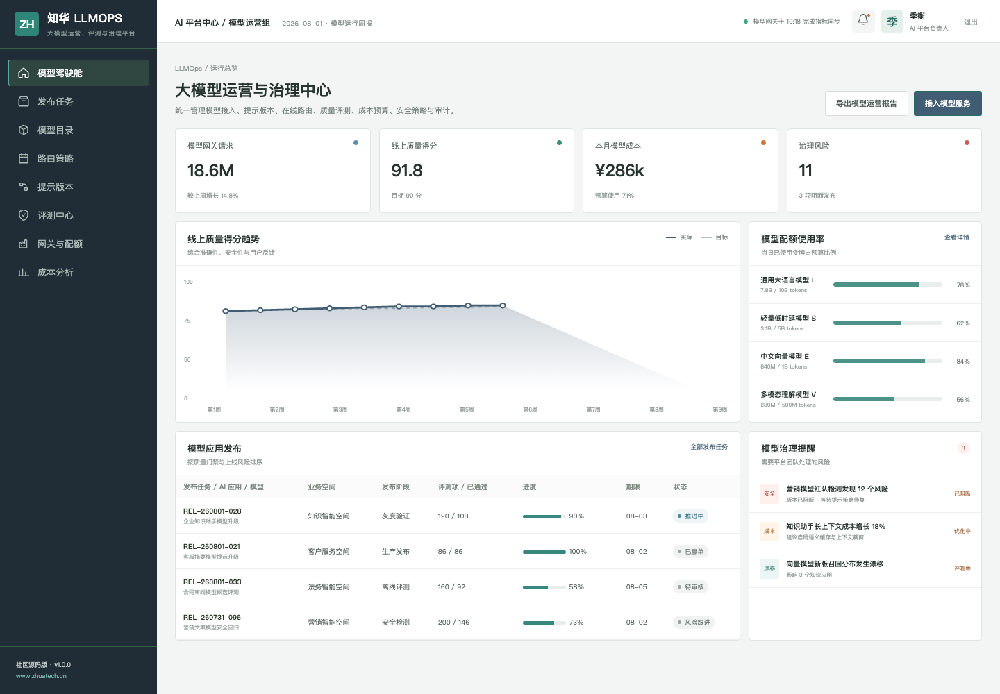
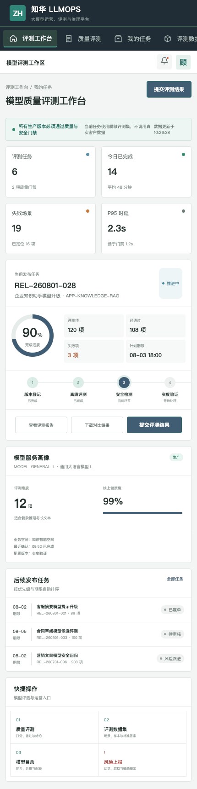

# ZhuaTech LLMOps

2026-10-23 功能更新：**灰度发布错误率置信区间**。使用 Wilson 95% 区间比较基线与灰度错误率，综合最小样本和延迟决定观察或回滚建议。数据由请求提交，不自动调整生产流量。 [接口、操作与边界说明](docs/AI_PRACTICAL_UPGRADE_20261023.md)。

[简体中文](README.md) | [English](README.en.md)


## 本次升级：模型服务错误预算与燃烧速率

基于目标成功率、周期请求和短窗口错误率，计算已用/剩余错误预算及短窗口燃烧倍数，零请求明确返回不可评估。

新增已认证的结构化录入工作台（`/operations.html`），支持批量核算、逐条结果依据、分级复核和CSV/完整JSON导出。结果由真实后端算法计算，不是预置演示数字。所有数值精确传递，不调用外部模型。

这是**只读核算**：不写库、不审批、不自动执行财务、签署、销毁或设备控制。输入条件满足不是执行授权。[算法、输入边界与接口说明](docs/OPERATIONS-REVIEW.md)。
## 大模型运营、评测与治理平台｜社区源码版

ZhuaTech LLMOps 由知华科技（上海如静知华信息科技有限公司）发布，帮助企业把不同模型、提示版本、评测标准、发布流程、在线指标、成本预算与安全策略纳入统一治理。

[知华科技官网](https://www.zhuatech.cn/)　[架构说明](docs/architecture.md)　[API 摘要](docs/api.md)　[许可边界](LICENSE)

### 运营驾驶舱



驾驶舱提供模型网关请求量、线上质量、成本预算、发布版本、配额负载和治理风险，支持 AI 平台负责人观察质量、稳定性与投入产出。

### 评测工作台



评测人员围绕业务数据集执行准确性、鲁棒性、安全性、时延和成本评测，评测结果与模型、提示、参数和数据集快照永久关联。

### 能力清单

| 领域 | 社区版能力 |
| --- | --- |
| 模型目录 | Provider、能力、上下文、价格、配额和健康状态 |
| 提示工程 | 模板、变量、版本、差异和发布记录 |
| 模型评测 | 场景集、黄金答案、离线评测、红队与对照实验 |
| 发布治理 | 质量门禁、人工审批、灰度流量、回滚和审计 |
| 在线运营 | 请求、时延、错误、令牌、缓存、成本和用户反馈 |
| 安全治理 | 幻觉、越权、隐私、偏见与敏感输出风险 |

最新版本增加统一发布门禁接口，将质量分、安全分、P95 时延、单位推理成本和人工审批汇总为 `RELEASE` 或 `HOLD` 决策，并返回失败门禁与当前阈值，便于流水线直接消费。

### 运行方式

服务端使用 Java 21 + Spring Boot，Web/H5 使用 Vue 3，数据层使用 MySQL 8 与 Flyway，测试使用 H2。包名 `cn.zhuatech.llmops`，数据库 `zhuatech_llmops`。仓库只提供模型 Provider 边界与演示数据，不含真实模型 API Key。

```bash
cd frontend
npm install
npm run dev:demo
```

企业管理端 `planner / Demo@2026`，评测端 `operator / Demo@2026`。全栈部署执行 `cp .env.example .env && docker compose up --build`。

### 许可与商业合作

仅限个人学习、研究和非商业技术交流，未经上海如静知华信息科技有限公司书面授权不得商用。企业内部部署、SaaS、项目实施、收费培训、咨询服务、品牌替换和商业再分发均属于商业使用，详见 [LICENSE](LICENSE)。

大模型平台、模型网关、LLMOps、私有化部署和定制开发，请访问[知华科技官网](https://www.zhuatech.cn/)或扫码咨询：

| 技术与方案咨询 | 商务与授权咨询 |
| --- | --- |
|  |  |

SEO 关键词：LLMOps 开源、模型评测平台、大模型治理、模型网关、Prompt 管理、AI 成本治理、Java LLMOps、知华科技。

## 模型调用成本预测

新增 `POST /api/llmops/insights/model-cost-forecast`，根据月请求量、输入输出 Token、缓存命中率、模型单价和月度预算预测成本，并输出 `WITHIN_BUDGET / WARNING / OVER_BUDGET`。结果包含预算使用率及缓存、输出长度、模型路由等优化动作，方便上线前完成 FinOps 评审。

## 企业级大模型上线治理

新增 `POST /api/enterprise/llmops/model-deployment`，覆盖评测、红队、隐私、版本、安全问题、责任、回滚、兜底和预算，返回 `DEPLOY / CANARY / BLOCKED`。详见 [模型上线说明](docs/ENTERPRISE_MODEL_DEPLOYMENT.md)。

## 灰度发布与稳定分流

`POST /api/enterprise/llmops/canary-release` 根据候选版本的样本量、错误率、P95 时延、安全事件以及回滚和兜底准备情况执行灰度门禁；通过后按租户、用户和发布版本生成稳定分桶，返回基线或候选模型版本。安全或 SLO 超标时返回 `ROLLBACK` 并建议路由到基线，样本不足返回 `HOLD`。接口是确定性的发布与路由决策，不会自行调用模型或修改生产流量配置，接入方应执行返回的决策。

## 输入对照与版本化快照

在既有「模型服务错误预算与燃烧速率」基础上，新增 `/comparison.html`：基准与候选两组数据都由当前真实算法重算，按编号展示新增、移除、逐字段变化和精确数值差，支持筛选、分页和全量导出。原核算入口可导出输入快照，对照页经后端完整校验后整体导入；失败不覆盖当前输入。

快照区分项目、字段契约及算法版本。建议较宽松不代表风险已下降，输入摘要不是签名；操作人和时间仅为响应元数据，不是持久化审计。本次未新增模型调用或业务写入，也不代表全系统生产认证。详见[输入对照操作与接口说明](docs/INPUT-COMPARISON.md)。
